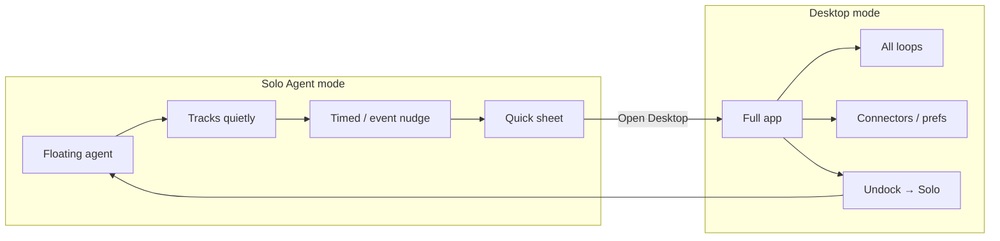
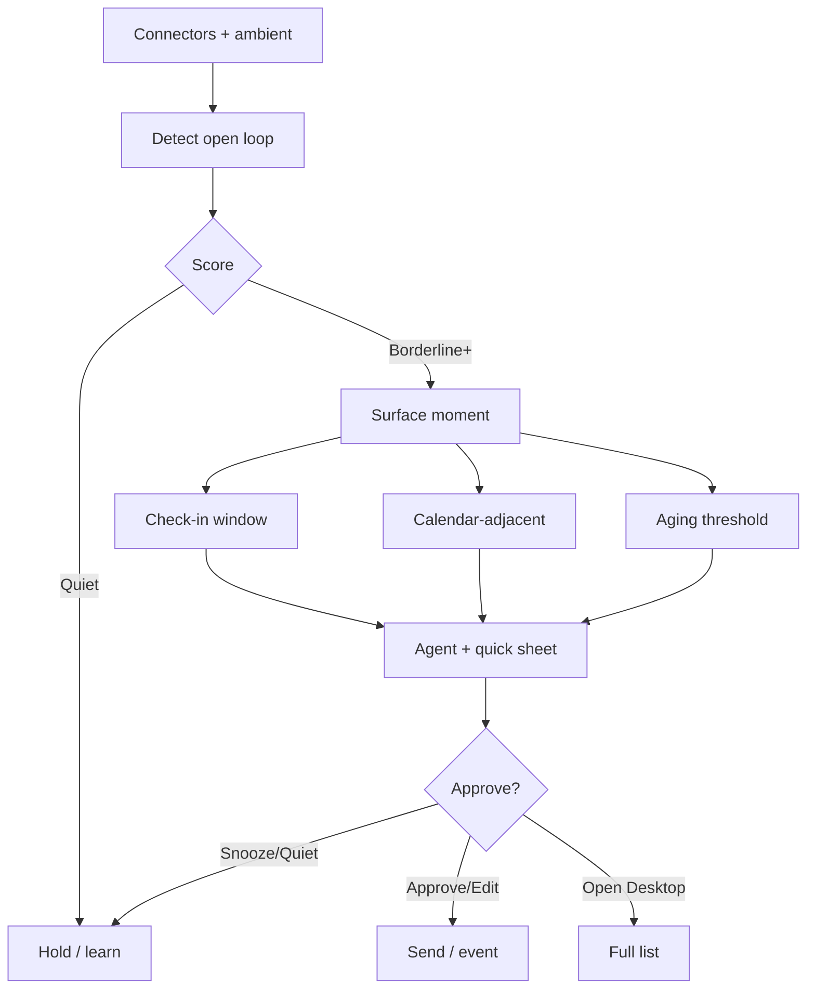
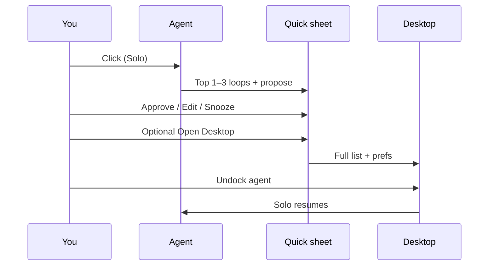

# Juvantage OS — Product & Desktop ship

**Status:** Working product doc (ship shape + UX)  
**Parent (business / ARR / ICP):** [`JUVANTAGE_OS_SCOPE.md`](./JUVANTAGE_OS_SCOPE.md)  
**Architecture / context / container / branches:** [`OS_ARCHITECTURE.md`](./OS_ARCHITECTURE.md)  
**Wireframes:** `assets/motion/desktop-ux-wireframes.html`

```text
CONTEXT STREAM  →  OPEN LOOPS  →  RIGHT-MOMENT SURFACE  →  PROPOSE → APPROVE → EXECUTE → VERIFY
```

---

## 1 · What V1 is

A **Mac desktop companion** that catches unfinished obligations and helps you close them — **nothing sends without approve** — with the locked teal agent as the face.

| Skin | Ship order | Who | Unit of work |
|------|------------|-----|--------------|
| **Personal** | **V1 / MVP** | You → busy operators | Reply owed, ask, unconfirmed appt, aging todo |
| **Teams** | After Personal dogfood | Agency / client-services desk | Loop + **owner + SLA** + audit |

V1 desktop = **Personal**. Teams is the paid path, not day-one RBAC.

---

## 2 · Agent symbol (LOCKED)

**Locked:** 2026-10-16  
**Asset:** `assets/motion/characters/mascot-idle-loop.json` — **do not overwrite** with experiments.

The first teal floating idle (cream face, eyes, blush, bob + blink) is **the visual symbol of Juvantage OS**.

| Use | Yes |
|-----|-----|
| Desktop click / summon | Yes |
| Future solo overlay | Same symbol |
| Marketing / waitlist / decks | Yes |

| Not this | Belongs to |
|----------|------------|
| Haven fox | Haven |
| Profile avatar dresser | Haven |
| Experimental OS blobs (01–07) | Drafts only |

**Meaning:** Tap symbol → right open loops → propose → **you approve** → execute → verify.  
Brain underneath can change; **symbol + approve gate** stay.

**Preview:** `assets/motion/live-lab.html` → Original idle (keep).

---

## 3 · Feature scope — Desktop MVP

### IN

| # | Feature | Notes |
|---|---------|--------|
| 1 | Mac app shell | Menu bar + floating agent + main window |
| 2 | Agent symbol | Locked Lottie; click → quick sheet |
| 3 | Gmail connector | Official API |
| 4 | Google Calendar connector | Detect / propose events |
| 5 | Loop schema | reply-owed, ask, appointment, todo |
| 6 | Score bands | Critical / Important / Borderline / Quiet |
| 7 | **Timed / right-moment triggers** | Check-in windows + aging + calendar-adjacent — **primary** |
| 8 | Floating assist (Solo Agent) | Nudge → **quick sheet** (not full app) |
| 9 | Desktop mode | Full loop list, connectors, prefs; undock → Solo |
| 10 | Propose actions | Draft reply, create event, snooze, quiet |
| 11 | **Approve gate** | No send/write without you |
| 12 | Verify close | Reply sent / event created |
| 13 | Quiet / snooze history | Teach what to stop surfacing |
| 14 | Local + cloud auth | Secrets not in client logs |
| 15 | Basic metrics | Clear rate, accept/dismiss |
| — | Optional inbox digest | Reyn-style email — **not V1 hero** |

**Credible Personal detection** also needs ambient / eyes layers — see [`OS_ARCHITECTURE.md`](./OS_ARCHITECTURE.md) § Context (mail-alone loses to Reyn).

### OUT (not V1)

- Autonomous send  
- Full Slack org dump / iMessage as launch requirement  
- Teams RBAC (next horizon)  
- Fine-tune as launch gate  
- Windows / Linux / mobile daemon as v1  
- Haven fox / jars  
- “Journal & ask anything” as homepage (that’s Reyn’s category)

### Near-term after MVP (Personal+)

- Extra connector (Slack *or* Linear/Notion)  
- Ambient app/URL/title + clip hotkey (if Fork 2) or episodic capture (if Fork 1/2)  
- Quiet classifiers from labels  
- Private beta ≈25  
- Agent polish (blink on notify, success Lottie)

### Prolonged / Teams

| Horizon | Focus |
|---------|--------|
| Teams lite | Shared Gmail *or* Twilio; Admin / Lead / Member; audit |
| Agency wedge | Owner + SLA; near-miss; metrics board |
| Trust ladder | Security FAQ → private tenant / VPC / **container brain** |
| Phone remote | Shortcuts / Siri App Intents → Brain API |

**Teams pieces:** shared stream, owner, SLA clock, RBAC approve, audit.  
**Not Teams v1:** dump everyone’s private Slack; autonomous client mail.

---

## 4 · UX — Solo Agent vs Desktop

**Locked:** Primary surface = **timed / right-moment nudges** via floating agent. Morning digest = optional. Approve = always on.



| | **Solo Agent** | **Desktop** |
|--|-----------------|-------------|
| Visible | Teal agent float | Full window; agent optional |
| Job | Track + nudge + **quick act** | Browse all + settings |
| Click agent | **Quick sheet** (not full app) | Same quick act or browse |
| Rule | Stays **fast** | Deliberate step up |

### Triggers



1. Clock windows (1–3/day — not “morning only”)  
2. Aging (e.g. reply unpaid 18h)  
3. Calendar-adjacent  

### Click flow



**UI map (locked):** [`OS_UI_MAP.md`](./OS_UI_MAP.md)  
**Mockups:** [`assets/mockups/os-ui/index.html`](../assets/mockups/os-ui/index.html)  
**Legacy wireframes:** `assets/motion/desktop-ux-wireframes.html`  

**Continuity rule:** Open Desktop = **widened Loops** (same loop + draft), not connectors-first.

### Open UX questions

1. Quick sheet = **1** loop or up to **3**?  
2. Default check-in times?  
3. Email digest in V1 or Personal+?  
4. Always-visible float vs menu-bar default?

---

## 5 · Intelligence (honest)

| Stage | Approach |
|-------|----------|
| V1 | LLM structured extract + rules |
| Next | Classifiers for priority/quiet on labeled loops |
| Later | Bedrock / fine-tunes only if evals justify |

Intelligence can swap; **approve gate + loop metaphor + agent symbol** cannot.

---

## 6 · Build order

**Executable checklist (follow day-to-day):** [`OS_BUILD_ROADMAP.md`](./OS_BUILD_ROADMAP.md)

| Phase | Deliver |
|-------|---------|
| **0–1** | Scaffold + Solo agent + empty quick sheet |
| **2** | Auth + Gmail + Calendar |
| **3** | Loop extract + score + triggers (+ ambient) |
| **4** | Propose + approve + verify |
| **5** | Desktop window + undock |
| **6** | Dogfood harden |
| **7** | Teams / container (later) |

**Success (2 weeks dogfood):** caught something you’d drop; approve felt safe; quiet not annoying; agent → useful sheet &lt; 2s.

---

## 7 · Open product decisions

1. Electron / Tauri / native Swift for shell?  
2. Control plane: existing `apps/api` vs new?  
3. LLM provider (adapter-friendly)?  
4. Beta invite count (25)?  
5. Teams vertical #1 still agencies?  
6. ~~**Screen fork**~~ → **LOCKED B** (screen-first episodic + presence) — `OS_ARCHITECTURE.md` §A6–A8 · staged V1→V3 in `FLAGSHIP_STAGED_PLAN.md`

---

## Related

- Business: `JUVANTAGE_OS_SCOPE.md`  
- Mechanism + container + voice branches: `OS_ARCHITECTURE.md`  
- Company map: `POSITIONING.md`  
- Haven (separate): `HAVEN_SOUL_DIRECTION.md`
